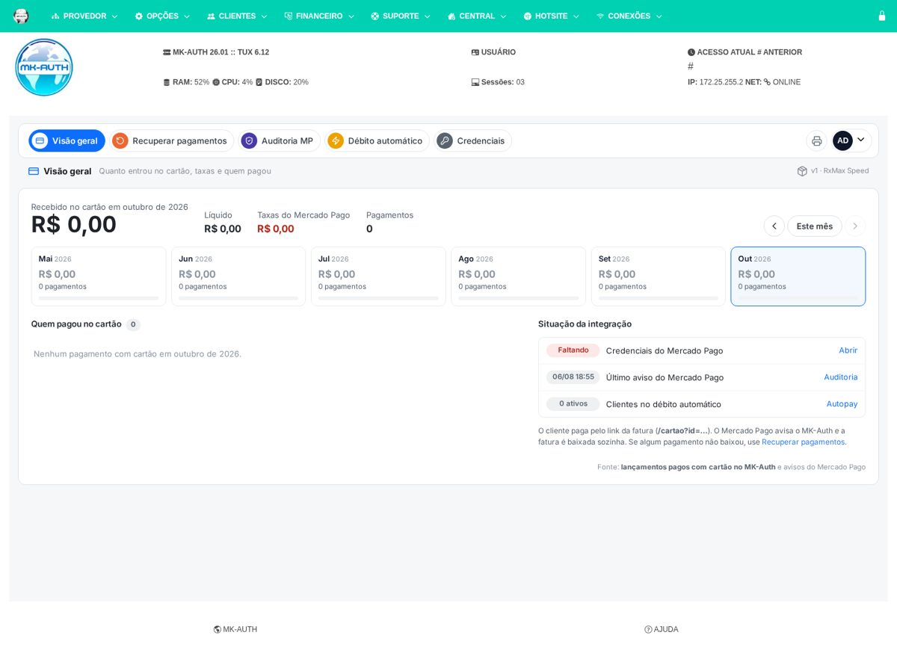
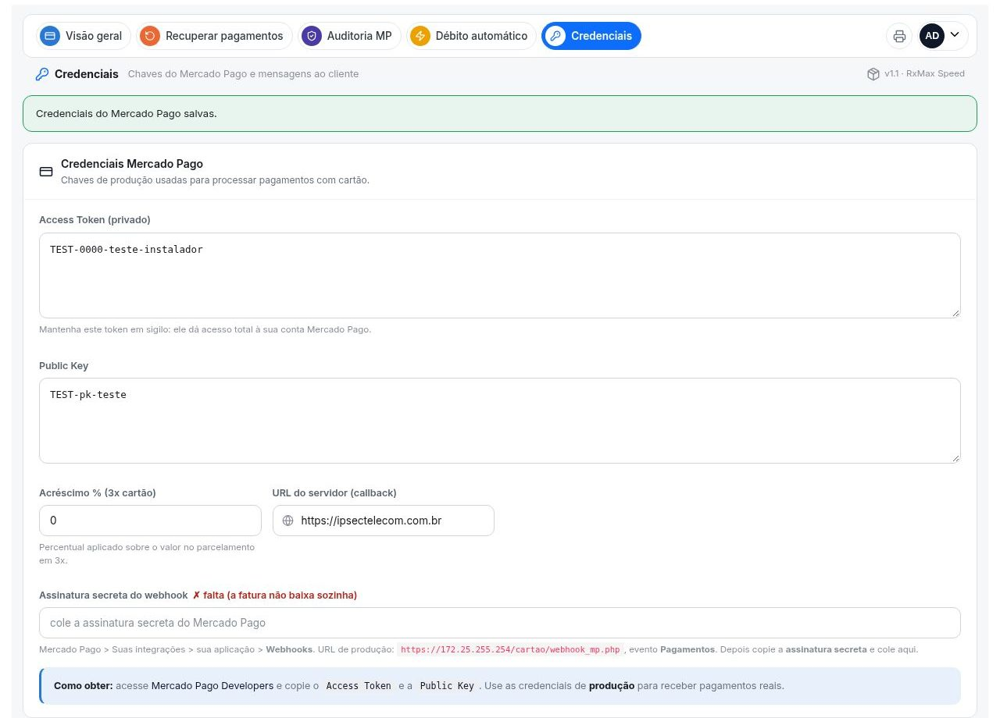

# 💳 Cartão de Crédito (addon do MK-Auth)

Pagamento de faturas com cartão pelo **Mercado Pago**. O cliente recebe um link curto, paga na página do provedor e a fatura é **baixada sozinha** quando o Mercado Pago avisa.

Versão atual: **1.1** (funciona em qualquer MK-Auth 2601+, com ou sem o Resumo de Pagamentos).

Telas do addon (menu **Financeiro > 💳 Cartão de Crédito**):

| Tela | Para que serve |
|---|---|
| Visão geral | Quanto entrou no cartão no mês, taxas, líquido, últimos 6 meses e quem pagou |
| Recuperar pagamentos | Acha pagamento aprovado no Mercado Pago que não baixou a fatura |
| Auditoria MP | Confere o Mercado Pago contra as faturas do MK-Auth |
| Débito automático | Clientes com cobrança automática no cartão |
| Credenciais | Chaves do Mercado Pago, assinatura do webhook, Telegram e mensagens ao cliente |

---

## Sumário

1. [O que precisa antes](#1-o-que-precisa-antes)
2. [Instalar no servidor](#2-instalar-no-servidor)
3. [Configurar o Mercado Pago](#3-configurar-o-mercado-pago)
4. [Testar](#4-testar)
5. [Como o cliente paga](#5-como-o-cliente-paga)
6. [Atualizar e remover](#6-atualizar-e-remover)
7. [Problemas comuns](#7-problemas-comuns)
8. [Migração (quem tinha o cartão dentro do Resumo de Pagamentos)](#8-migração-quem-tinha-o-cartão-dentro-do-resumo-de-pagamentos)
9. [Para quem desenvolve](#9-para-quem-desenvolve)

---

## 1. O que precisa antes

| Precisa de | Detalhe |
|---|---|
| **MK-Auth 2601 ou mais novo** | Com PHP 8. O instalador confere e avisa se não for. |
| **Acesso root ao servidor do MK-Auth** | Usuário `root` e a senha do servidor (a do SSH). |
| **WinSCP e PuTTY** (Windows) | Para copiar o arquivo e rodar o comando. |
| **Conta no Mercado Pago** | Com uma aplicação criada em *Suas integrações*. É de lá que saem o Access Token, a Public Key e a assinatura secreta do webhook. |
| **MK-Auth abrindo em https** | O Mercado Pago só manda aviso de pagamento para endereço **https** (ex.: `https://seuprovedor.com.br`). |

> O addon não mexe nos clientes nem nos planos. Ele só **baixa a fatura** que o cliente pagou no cartão (como uma baixa feita à mão) e grava nas próprias tabelas.

---

## 2. Instalar no servidor

### 2.1 Copiar o arquivo

1. Abra o **WinSCP**: Protocolo **SFTP**, Host = **IP do servidor do MK-Auth**, Porta **22**, Usuário **root** e a senha. Clique em **Login**.
2. No lado do servidor, vá para **`/tmp`**.
3. Arraste o arquivo **`cartao_credito_v1.1.zip`** para dentro de `/tmp`.

### 2.2 Rodar o instalador

No terminal do servidor (WinSCP: **Comandos > Abrir terminal**, ou PuTTY), cole e aperte **Enter**:

```bash
cd /tmp && unzip -o cartao_credito_v1.1.zip && cd cartao_credito_v1.1 && php instalar/instalar.php
```

Deve aparecer:

```
💳 Cartão de Crédito (Mercado Pago) — instalação

✅ PHP 8.0.30 com curl, openssl e mysqli.
✅ Banco do MK-Auth acessado.
✅ 129 arquivos copiados para /opt/mk-auth/admin/addons/cartao_credito
✅ Tabelas prontas (só cria o que falta).
✅ Link curto criado em /var/www/cartao (https://SEU-DOMINIO/cartao?id=FATURA).
✅ Menu "💳 Cartão de Crédito" adicionado em Financeiro
✅ Débito automático agendado (/etc/cron.d/cartao_credito, todo dia às 9h).
✅ Sintaxe dos arquivos conferida.

🎉 Pronto!
```

Se a senha do MySQL do seu MK-Auth **não for a padrão**, o instalador pergunta. Também dá para passar direto: `php instalar/instalar.php --dbpass=SUA_SENHA`.

O que o instalador fez:
- copiou o addon para `/opt/mk-auth/admin/addons/cartao_credito`;
- criou as tabelas que faltavam no banco;
- criou o link curto `https://SEU-DOMINIO/cartao?id=FATURA` (pasta `/var/www/cartao`);
- pôs **💳 Cartão de Crédito** no menu **Financeiro**;
- agendou o débito automático (todo dia às 9h);
- guardou backup do que mexeu em `/root/bk_cartao_credito`.

Não precisa editar nenhum arquivo: o resto se configura pela tela.

---

## 3. Configurar o Mercado Pago

Abra o MK-Auth, aperte **Ctrl+F5** e entre em **Financeiro > 💳 Cartão de Crédito > Credenciais**.

### 3.1 Access Token e Public Key

1. Entre em [Mercado Pago Developers > Suas integrações](https://www.mercadopago.com.br/developers/panel/app) e abra a sua aplicação (ou crie uma: *Criar aplicação*, tipo *Pagamentos online*).
2. Em **Credenciais de produção**, copie o **Access Token** e a **Public Key**.
3. Cole nos campos **Access Token** e **Public Key** da tela Credenciais.
4. **Acréscimo % (3x cartão)**: quanto acrescentar no parcelamento em 3x (ex.: `5`). Deixe `0` para não cobrar acréscimo.
5. **URL do servidor**: o endereço https do seu MK-Auth (ex.: `https://seuprovedor.com.br`).

### 3.2 Webhook (aviso de pagamento)

É o que faz a fatura **baixar sozinha**.

1. No Mercado Pago, na sua aplicação, abra **Webhooks > Configurar notificações**.
2. **URL de produção:** `https://SEU-DOMINIO/cartao/webhook_mp.php` (a tela Credenciais já mostra o endereço certo do seu servidor).
3. Evento: marque **Pagamentos**. Salve.
4. O Mercado Pago mostra a **Assinatura secreta**: copie.
5. Cole no campo **Assinatura secreta do webhook** da tela Credenciais.

### 3.3 Mensagens e Telegram

- **Mensagens de pagamento:** textos que o cliente recebe ao pedir, confirmar ou ter o pagamento recusado.
- **Alertas no Telegram (opcional):** token do bot e ID do grupo. O addon avisa quando o webhook recusar um aviso ou algo der errado. Para criar: fale com **@BotFather** (`/newbot`), ponha o bot num grupo e pegue o ID em `https://api.telegram.org/botSEU_TOKEN/getUpdates`.

Clique em **Salvar credenciais**. O campo da assinatura passa a mostrar **✓ configurada**.

---

## 4. Testar

1. **Link do cliente:** abra `https://SEU-DOMINIO/cartao?id=NUMERO_DE_UMA_FATURA_EM_ABERTO`. Tem que aparecer a página de pagamento da fatura (abas **Cartão** e **Boleto**).
2. **Webhook recusando aviso falso** (no terminal do servidor ou no seu computador):
   ```bash
   curl -X POST https://SEU-DOMINIO/cartao/webhook_mp.php
   ```
   Tem que responder **401** (recusa aviso sem assinatura; é o certo).
3. **Webhook aceitando o Mercado Pago:** na tela de Webhooks do Mercado Pago, use **Simular notificação**. Tem que dar **200**.
4. **Primeiro pagamento real:** pague uma fatura pequena com cartão e confira se ela **baixou sozinha** e apareceu na **Visão geral**.

---

## 5. Como o cliente paga

- Mande para o cliente o link `https://SEU-DOMINIO/cartao?id=NUMERO_DA_FATURA` (pelo WhatsApp, SMS ou no aviso de cobrança).
- Ele escolhe **Cartão** (à vista ou 3x, com o acréscimo que você configurou) ou **Boleto**.
- **Aba PIX:** aparece quando a fatura tem Pix no boleto (Efí/Gerencianet) ou quando o servidor tem o Resumo de Pagamentos (botão "Receber PIX no WhatsApp"). Sem nenhum dos dois, a aba não aparece.
- Pagou no cartão: o Mercado Pago avisa o webhook e a fatura é baixada na hora.
- **Débito automático:** o cliente pode cadastrar o cartão para cobrança automática todo mês (aba Débito automático mostra quem tem).

---

## 6. Atualizar e remover

**Atualizar** para uma versão nova: copie o .zip novo para `/tmp` e rode o mesmo comando, trocando a versão:

```bash
cd /tmp && unzip -o cartao_credito_v1.2.zip && cd cartao_credito_v1.2 && php instalar/instalar.php
```

Guarda a versão anterior em `/root/bk_cartao_credito` e **não troca** a configuração do servidor (`rp_config_local.php`, chaves e credenciais).

**Remover:**

```bash
cd /tmp/cartao_credito_v1.1 && php instalar/instalar.php --remover
```

Tira o menu, o agendamento e o link curto, e guarda a pasta em `/root/bk_cartao_credito`. Credenciais, auditoria e débito automático continuam no banco: reinstalar volta tudo.

---

## 7. Problemas comuns

| Problema | Solução |
|---|---|
| `unzip: command not found` | `apt-get install -y unzip` e repita o comando. |
| ❌ **"Rode como root"** | Entre como root (ou `sudo -i` antes). |
| ❌ **"roda PHP 7 na web"** | MK-Auth antigo (antes da 2601). Atualize o MK-Auth. |
| ❌ **"Não consegui entrar no banco"** | Rode com a senha do MySQL: `php instalar/instalar.php --dbpass=SENHA`. |
| ⚠️ **"/var/www/cartao já existe e aponta para outro lugar"** | O servidor já tinha cartão pelo Resumo de Pagamentos: veja a [Migração](#8-migração-quem-tinha-o-cartão-dentro-do-resumo-de-pagamentos). |
| Menu não aparece | Ctrl+F5. Ou abra `/admin/addons/cartao_credito/` direto. |
| Cliente pagou e a fatura **não baixou** | Assinatura do webhook errada ou vazia (Credenciais mostra ✗), ou webhook não cadastrado no Mercado Pago. Use **Recuperar pagamentos** para baixar as que ficaram. |
| Simular notificação dá **401** | A assinatura colada não é a da mesma aplicação/ambiente (produção). Copie de novo e salve. |
| `/cartao?id=...` dá "Não encontrado" | `/var/www/cartao/` não existe ou o Apache não serve `/var/www` em `/cartao`. Rode o instalador de novo. |
| Página do cliente sem aba **PIX** | Normal sem Pix no boleto (Efí) e sem o Resumo de Pagamentos. Cartão e boleto funcionam. |
| Alertas do Telegram não chegam | Confira token e ID do grupo na tela Credenciais; o bot precisa estar no grupo. |

---

## 8. Migração (quem tinha o cartão dentro do Resumo de Pagamentos)


Use quando o servidor já cobra cartão pelo **Resumo de Pagamentos** antigo. Foi assim na RxMax em 09/10/2026.

1. Copie o addon e a configuração do próprio Resumo:
   ```
   D=/opt/mk-auth/admin/addons/cartao_credito
   R=/opt/mk-auth/admin/addons/Resumo_Pagamentos
   mkdir -p $D && rsync -a --exclude .git --exclude instalar --exclude publico --exclude README.md /root/cartao-credito/ $D/
   cp -p $R/rp_config_local.php $R/.rp_autokey $D/
   mkdir -p $D/logs && chmod 777 $D/logs && chown -R www-data:www-data $D
   ```
2. Rode a migração:
   ```
   mkdir -p /tmp/cc_deploy && cp -a /root/cartao-credito/instalar/. /root/cartao-credito/publico /tmp/cc_deploy/
   PHPB=/opt/php8/bin/php bash /tmp/cc_deploy/aplica.sh
   ```
   Ela guarda backup em `/root/bk_separa_cartao_<data>` e:
   - troca `pagamento.php`, `webhook_mp.php` e `autopay_publico.php` do Resumo por atalhos para o addon novo (os links que o cliente já recebeu continuam funcionando);
   - tira Recuperar, Auditoria e a aba Cartão do Resumo (os endereços antigos levam para o addon novo);
   - aponta `/var/www/cartao` e o cron do débito automático para o addon novo;
   - põe o item no menu **Financeiro**.

O endereço do webhook no Mercado Pago **não muda**. Siga para [Configurar o Mercado Pago](#3-configurar-o-mercado-pago) (pule o webhook se ele já estava cadastrado).

---

## 9. Para quem desenvolve

| Caminho | Vai para | O que é |
|---|---|---|
| raiz (`*.php`, `assets/`) | `/opt/mk-auth/admin/addons/cartao_credito/` | o addon |
| `publico/cartao/` | `/var/www/cartao/` | link curto `/cartao?id=...` e endereço público do webhook |
| `instalar/instalar.php` | roda no servidor | instalação nova, atualização e `--remover` |
| `instalar/aplica.sh` | roda no servidor | migração de quem tinha o cartão dentro do Resumo de Pagamentos |
| `instalar/tabelas.sql` | banco `mkradius` | cria as tabelas que faltarem |
| `rp_config_local.exemplo.php` | (opcional) `rp_config_local.php` | só se a senha do banco não for a padrão; o instalador cria sozinho |
| `docs/prints/` | só no GitHub | imagens do README |

**Não vão para o GitHub:** `rp_config_local.php` e `.rp_autokey`. Cada servidor tem os seus.

**Gerar o pacote para entregar:** copiar os arquivos do repositório (sem `.git` e `docs/`) para `cartao_credito_vX.Y/` e compactar em `cartao_credito_vX.Y.zip`. Ao mudar a versão, atualizar `version` no `manifest.json`.

## Como fica instalado

*(prints do MK-Auth de teste)*

**Visão geral** (Financeiro > 💳 Cartão de Crédito):



**Credenciais**:


