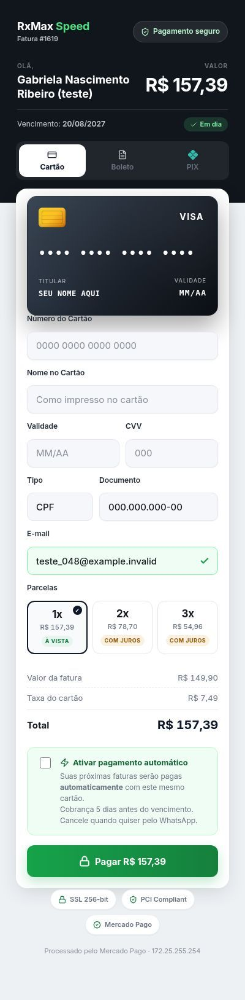
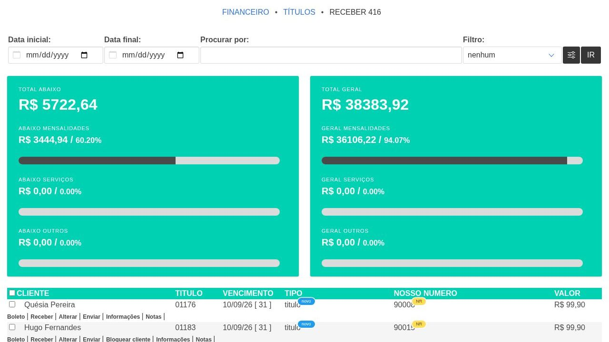
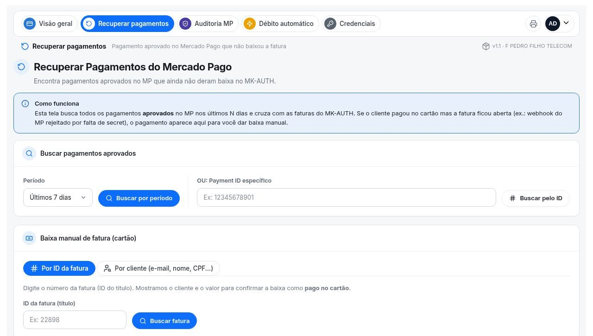
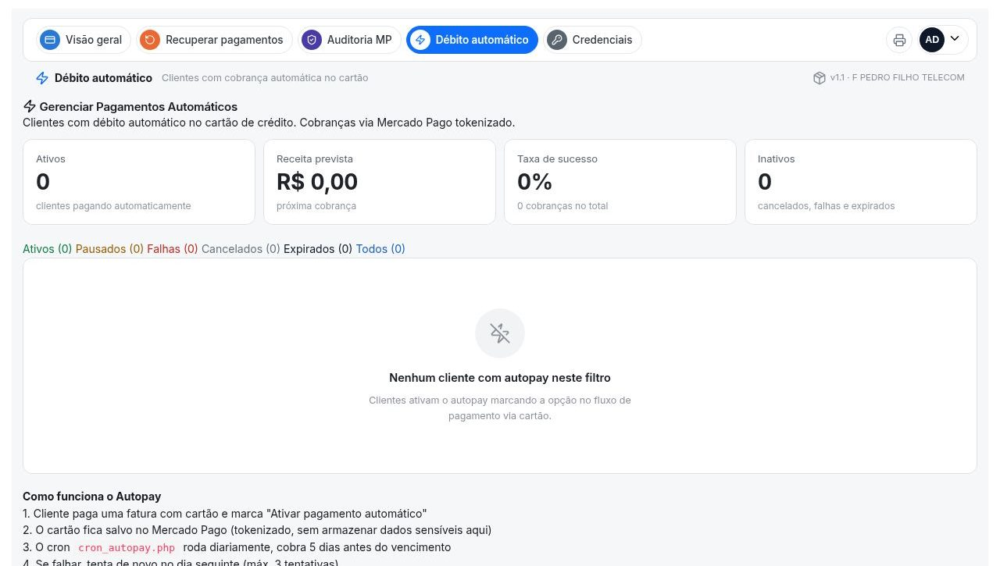

# 💳 Cartão de Crédito (addon do MK-Auth)

Pagamento de faturas com cartão pelo **Mercado Pago**. O cliente recebe um link curto, paga na página do provedor e a fatura é **baixada sozinha** quando o Mercado Pago avisa.

Versão atual: **1.1**. Funciona em qualquer MK-Auth 2601 ou mais novo, com ou sem o addon Resumo de Pagamentos.

| Como o cliente vê (celular) | Como você vê (MK-Auth) |
|---|---|
|  |  |

---

## Sumário

1. [O que precisa antes](#1-o-que-precisa-antes)
2. [Instalar no servidor](#2-instalar-no-servidor)
3. [Criar a aplicação no Mercado Pago](#3-criar-a-aplicação-no-mercado-pago)
4. [Preencher a tela Credenciais](#4-preencher-a-tela-credenciais)
5. [Cadastrar o webhook (baixa automática)](#5-cadastrar-o-webhook-baixa-automática)
6. [Testar antes de mandar para os clientes](#6-testar-antes-de-mandar-para-os-clientes)
7. [Mandar o link para o cliente](#7-mandar-o-link-para-o-cliente)
8. [Uso no dia a dia (cada aba)](#8-uso-no-dia-a-dia-cada-aba)
9. [Atualizar, remover e problemas comuns](#9-atualizar-remover-e-problemas-comuns)
10. [Migração (quem tinha o cartão dentro do Resumo de Pagamentos)](#10-migração-quem-tinha-o-cartão-dentro-do-resumo-de-pagamentos)
11. [Para quem desenvolve](#11-para-quem-desenvolve)

---

## 1. O que precisa antes

| Precisa de | Detalhe |
|---|---|
| **MK-Auth 2601 ou mais novo** | Com PHP 8. O instalador confere e avisa se não for. |
| **Acesso root ao servidor do MK-Auth** | Usuário `root` e a senha do servidor (a do SSH, não a do painel). |
| **WinSCP** (Windows) | Para copiar o arquivo para o servidor e abrir o terminal. Baixe em [winscp.net](https://winscp.net). |
| **Conta no Mercado Pago** | Pode ser a conta da empresa. Vai criar uma "aplicação" nela (passo 3). |
| **MK-Auth abrindo em https** | O Mercado Pago só avisa pagamento em endereço **https**. |

**Como saber se o seu MK-Auth abre em https:** no navegador, abra `https://SEU-DOMINIO/admin/` (ex.: `https://seuprovedor.com.br/admin/`). Se abrir com o **cadeado** ao lado do endereço, está certo. Se der erro de certificado ou não abrir, resolva isso antes (é configuração do servidor/domínio, não do addon).

> O addon não mexe nos clientes nem nos planos. Ele só **baixa a fatura** que o cliente pagou no cartão (igual a uma baixa feita à mão, com forma de pagamento "cartão") e grava nas próprias tabelas.

---

## 2. Instalar no servidor

### 2.1 Copiar o arquivo para o servidor

1. Abra o **WinSCP**. Na tela *Login*:
   - **Protocolo do arquivo:** SFTP
   - **Nome do host:** IP do servidor do MK-Auth (ex.: `192.168.0.10`)
   - **Porta:** 22
   - **Nome de usuário:** `root`
   - **Senha:** a senha do root do servidor
2. Clique em **Login**. Na primeira vez ele pergunta se confia no servidor: clique em **Sim**.
3. O lado **direito** é o servidor. Clique na barra de endereço dele, apague o que estiver lá, digite `/tmp` e aperte Enter.
4. No lado **esquerdo** (seu computador), ache o arquivo **`cartao_credito_v1.1.zip`** e **arraste** para o lado direito.

### 2.2 Rodar o instalador

1. No WinSCP, abra o terminal: menu **Comandos > Abrir terminal** (ou **Ctrl+T**). Se perguntar, clique em **OK**.
2. No campo **Digite o comando**, cole a linha abaixo e clique em **Executar**:

```bash
cd /tmp && unzip -o cartao_credito_v1.1.zip && cd cartao_credito_v1.1 && php instalar/instalar.php
```

3. Espere uns segundos. Tem que aparecer:

```
💳 Cartão de Crédito (Mercado Pago) — instalação

✅ PHP 8.0.30 com curl, openssl e mysqli.
✅ Banco do MK-Auth acessado.
✅ 129 arquivos copiados para /opt/mk-auth/admin/addons/cartao_credito
✅ Tabelas prontas (só cria o que falta).
✅ Link curto criado em /var/www/cartao (https://SEU-DOMINIO/cartao?id=FATURA).
✅ Menu "💳 Cartão de Crédito" adicionado em Financeiro
✅ Débito automático agendado (/etc/cron.d/cartao_credito, todo dia às 9h).
✅ Sintaxe dos arquivos conferida.

🎉 Pronto!
```

- Linha com **❌**: leia a mensagem e veja [Problemas comuns](#93-problemas-comuns).
- Se a senha do MySQL do seu MK-Auth **não for a padrão**, ele pergunta a senha. Também dá para passar direto: `php instalar/instalar.php --dbpass=SUA_SENHA` (no terminal do WinSCP, que não aceita pergunta, use assim).

O que o instalador fez:
- copiou o addon para `/opt/mk-auth/admin/addons/cartao_credito`;
- criou as tabelas que faltavam no banco;
- criou o link curto `https://SEU-DOMINIO/cartao?id=FATURA` (pasta `/var/www/cartao`);
- pôs **💳 Cartão de Crédito** no menu **Financeiro** do MK-Auth;
- agendou o débito automático (todo dia às 9h);
- guardou backup do que mexeu em `/root/bk_cartao_credito`.

Não precisa editar nenhum arquivo: o resto é pela tela.

### 2.3 Abrir o addon

Abra o MK-Auth no navegador e aperte **Ctrl+F5** (recarrega sem cache, para o menu novo aparecer). Entre em **Financeiro > 💳 Cartão de Crédito**.

---

## 3. Criar a aplicação no Mercado Pago

A "aplicação" é o que dá as chaves para o addon cobrar na sua conta.

1. Entre em **[mercadopago.com.br/developers/panel/app](https://www.mercadopago.com.br/developers/panel/app)** com a conta do Mercado Pago da empresa.
2. Clique em **Criar aplicação**.
   - **Nome:** o que quiser (ex.: `MK-Auth Cartão`).
   - Tipo de pagamento: **Pagamentos online**.
   - Se perguntar se usa plataforma de e-commerce: **Não**.
   - Produto: **Checkout Transparente** (ou "API de pagamentos" / "Checkout API").
   - Aceite os termos e clique em **Criar aplicação**.
3. Abra a aplicação criada. No menu da esquerda, em **Produção**, clique em **Credenciais de produção**.
4. Se estiver bloqueado, clique em **Ativar credenciais**: escolha o ramo (**Telecomunicações** / serviços), informe o site do provedor, aceite e confirme.
5. Vão aparecer a **Public Key** (começa com `APP_USR-`) e o **Access Token** (também começa com `APP_USR-`, é bem maior). Deixe essa página aberta: vai copiar no passo 4.

> ⚠️ Use as credenciais de **produção**. As "de teste" (`TEST-...`) não cobram de verdade.
> ⚠️ O **Access Token** dá acesso à sua conta: não mande para ninguém nem poste em grupo.

---

## 4. Preencher a tela Credenciais

No MK-Auth: **Financeiro > 💳 Cartão de Crédito > Credenciais**.


| Campo | O que pôr |
|---|---|
| **Access Token** | O Access Token de produção (passo 3). |
| **Public Key** | A Public Key de produção (passo 3). |
| **Acréscimo no parcelado (%)** | Quanto somar no **2x**; no **3x** é o dobro. Ex.: `5` → 2x com +5% e 3x com +10%. `0` = parcela sem acréscimo. |
| **Taxa no cartão à vista, 1x (%)** | Somada quando o cliente paga 1x (aparece como "Taxa do cartão"). **Vazio = 5%**. `0` = não cobra taxa. |
| **URL do servidor** | O endereço https do seu MK-Auth (ex.: `https://seuprovedor.com.br`). O débito automático usa para o aviso de pagamento. |
| **Nome que o cliente vê** | Aparece no topo da página de pagamento e na fatura do cartão do cliente (cobrança automática). Vazio = nome do provedor cadastrado no MK-Auth. |
| **Assinatura secreta do webhook** | Fica para o passo 5. |
| **Alertas no Telegram** (opcional) | Token do bot e ID do grupo (veja abaixo). |
| **Mensagens de pagamento** | Textos para o cliente ao pedir, confirmar ou recusar o pagamento. |

Clique em **Salvar credenciais** (botão azul no fim da página). Aparece *"Credenciais do Mercado Pago salvas."*

**Telegram (opcional):** avisa você quando o Mercado Pago mandar um aviso que o addon recusou (assinatura errada) ou algo der errado.
1. No Telegram, fale com **@BotFather**, mande `/newbot`, escolha um nome e um usuário terminado em `bot`. Ele responde com o **token** (`123456789:ABC...`).
2. Crie um grupo, adicione o bot e mande qualquer mensagem no grupo.
3. No navegador, abra `https://api.telegram.org/botSEU_TOKEN/getUpdates` (troque `SEU_TOKEN`). Procure `"chat":{"id":-100...`: esse número (com o sinal de menos) é o **ID do grupo**.
4. Cole token e ID na tela Credenciais e salve.

---

## 5. Cadastrar o webhook (baixa automática)

O webhook é o aviso que o Mercado Pago manda quando um pagamento é aprovado. **Sem ele, a fatura não baixa sozinha.**

1. No Mercado Pago, na sua aplicação, menu da esquerda: **Webhooks** (em *Notificações*) > **Configurar notificações**.
2. Na aba **Modo produção**:
   - **URL:** `https://SEU-DOMINIO/cartao/webhook_mp.php`. A tela Credenciais do addon mostra o endereço certo do seu servidor, logo abaixo do campo da assinatura: copie de lá.
   - **Eventos:** marque **Pagamentos**.
3. Clique em **Salvar configurações**.
4. Na mesma tela aparece a **Assinatura secreta** (clique no ícone de olho para ver). **Copie**.
5. No MK-Auth, tela **Credenciais**, cole no campo **Assinatura secreta do webhook** e clique em **Salvar credenciais**.
6. O campo passa a mostrar **✓ configurada**.

---

## 6. Testar antes de mandar para os clientes

1. **Link do cliente:** pegue o número de uma fatura em aberto (veja o [passo 7](#7-mandar-o-link-para-o-cliente)) e abra `https://SEU-DOMINIO/cartao?id=NUMERO`. Tem que aparecer a página de pagamento com o nome do seu provedor, o nome do cliente e o valor.
2. **Webhook recusa aviso falso:** no terminal do servidor (WinSCP, Ctrl+T), rode:
   ```bash
   curl -s -o /dev/null -w "%{http_code}\n" -X POST https://SEU-DOMINIO/cartao/webhook_mp.php
   ```
   Tem que aparecer **401**. É o certo: ele recusa aviso sem assinatura do Mercado Pago.
3. **Webhook aceita o Mercado Pago:** na tela de Webhooks do Mercado Pago, clique em **Simular notificação**, escolha **Pagamentos** e envie. O resultado tem que ser **200**. Se der **401**, a assinatura colada está errada: copie de novo.
4. **Pagamento real pequeno:** gere uma fatura de teste de valor baixo (ex.: R$ 5,00) para você mesmo, pague pelo link com o seu cartão e confira:
   - a fatura ficou **paga** no MK-Auth sozinha, em segundos;
   - o pagamento aparece na aba **Visão geral** do addon.

Se os 4 passaram, pode mandar o link para os clientes.

---

## 7. Mandar o link para o cliente

O link é sempre:

```
https://SEU-DOMINIO/cartao?id=NUMERO_DA_FATURA
```

**Onde achar o número da fatura:** no MK-Auth, **Financeiro > Títulos a receber** (ou na ficha do cliente, aba financeiro). É o número da coluna **TÍTULO**. Pode usar com ou sem os zeros da frente (`01176` ou `1176`).



Exemplo: título `01176` → `https://seuprovedor.com.br/cartao?id=1176`

Mensagem de exemplo para o WhatsApp:

```
Olá! Sua fatura de outubro já está disponível.
Pague com cartão de crédito (à vista ou em até 3x) por este link:
https://seuprovedor.com.br/cartao?id=1176
A baixa é automática.
```

**O que o cliente vê** (imagem no topo desta página):
- nome do provedor, nome dele, valor e vencimento;
- abas **Cartão** e **Boleto** (e **PIX**, quando a fatura tem Pix no boleto Efí ou o servidor tem o Resumo de Pagamentos);
- no cartão: número, nome, validade, CVV, CPF e e-mail, e as opções **1x, 2x ou 3x** já com o valor de cada uma;
- a opção **"Ativar pagamento automático"**: se marcar, as próximas faturas são cobradas sozinhas no mesmo cartão, 5 dias antes do vencimento.

Os dados do cartão vão direto para o Mercado Pago: o servidor do provedor não guarda número nem CVV.

---

## 8. Uso no dia a dia (cada aba)

### Visão geral
Quanto entrou no cartão no mês, taxas do Mercado Pago, valor líquido, os últimos 6 meses e a lista de quem pagou. Abra no começo do mês para conferir.

### Recuperar pagamentos
Para quando o cliente **pagou no cartão mas a fatura continuou em aberto** (ex.: webhook não estava cadastrado, assinatura errada, servidor fora do ar na hora do aviso).



1. Em **Período**, escolha (ex.: *Últimos 7 dias*) e clique em **Buscar por período**. Ou, se tiver o número do pagamento do Mercado Pago, cole em **Payment ID** e clique em **Buscar pelo ID**.
2. Aparece cada pagamento **aprovado** no Mercado Pago que não baixou fatura. Confira e clique para dar baixa.
3. **Baixa manual de fatura (cartão):** digite o número da fatura (TÍTULO) ou busque o cliente, confira o valor e confirme a baixa como **pago no cartão**.

### Auditoria MP
Confere o Mercado Pago contra as faturas do MK-Auth num mês inteiro. Escolha o **Mês de referência** e clique em **Gerar relatório**: mostra o que bateu, o que está no Mercado Pago sem baixa no MK-Auth e o contrário. Bom para fechar o mês.

### Débito automático
Clientes que marcaram **"Ativar pagamento automático"** na página de pagamento.



- Todo dia às 9h o addon cobra no cartão salvo as faturas que vencem em 5 dias. Aprovada, a fatura baixa sozinha (pelo webhook).
- Se a cobrança falhar (cartão recusado, sem limite), tenta de novo no dia seguinte. Depois de 3 falhas seguidas, desliga o débito automático daquele cliente.
- Filtros: **Ativos**, **Pausados**, **Falhas**, **Cancelados**, **Expirados**.
- Em cada cliente: **pausar**, **cancelar** (remove o cartão do Mercado Pago), ver o histórico e **copiar o link de gerenciar** (página onde o próprio cliente vê e cancela o débito automático).
- Avisos ao cliente pelo WhatsApp (cobrança feita, falha, link de gerenciar) só saem se o servidor tiver o envio de WhatsApp do Resumo de Pagamentos. Sem ele, mande o link de gerenciar você mesmo quando o cliente pedir.

### Credenciais
Tudo do [passo 4](#4-preencher-a-tela-credenciais). Volte aqui para trocar as chaves do Mercado Pago, as taxas, o nome ou as mensagens.

---

## 9. Atualizar, remover e problemas comuns

### 9.1 Atualizar

Copie o .zip novo para `/tmp` (igual ao passo 2.1) e rode o mesmo comando, trocando o número da versão:

```bash
cd /tmp && unzip -o cartao_credito_v1.2.zip && cd cartao_credito_v1.2 && php instalar/instalar.php
```

Guarda a versão anterior em `/root/bk_cartao_credito` e **não troca** a configuração do servidor (chaves, taxas, assinatura, `rp_config_local.php`).

### 9.2 Remover

```bash
cd /tmp/cartao_credito_v1.1 && php instalar/instalar.php --remover
```

Tira o menu, o agendamento e o link curto, e guarda a pasta em `/root/bk_cartao_credito`. Credenciais, auditoria e débito automático continuam no banco: reinstalar volta tudo.

### 9.3 Problemas comuns

| Problema | Solução |
|---|---|
| `unzip: command not found` | Rode `apt-get install -y unzip` e repita o comando. |
| ❌ **"Rode como root"** | Entre como root (ou rode `sudo -i` antes). |
| ❌ **"roda PHP 7 na web"** | MK-Auth antigo (antes da 2601). Atualize o MK-Auth. |
| ❌ **"Não consegui entrar no banco"** | Rode com a senha do MySQL: `php instalar/instalar.php --dbpass=SENHA`. |
| ⚠️ **"/var/www/cartao já existe e aponta para outro lugar"** | O servidor já tinha cartão pelo Resumo de Pagamentos: veja a [Migração](#10-migração-quem-tinha-o-cartão-dentro-do-resumo-de-pagamentos). |
| Menu não aparece | Ctrl+F5. Ou abra `/admin/addons/cartao_credito/` direto. |
| Página do cliente diz que a fatura não foi encontrada | Confira o número (coluna TÍTULO) e se a fatura não foi apagada. |
| `/cartao?id=...` dá "Não encontrado" | `/var/www/cartao/` não existe ou o Apache não serve `/var/www` em `/cartao`. Rode o instalador de novo. |
| Cartão recusado na página | Mensagem vem do Mercado Pago (sem limite, dados errados, banco recusou). O cliente tenta outro cartão. |
| Cliente pagou e a fatura **não baixou** | Assinatura do webhook vazia ou errada (Credenciais mostra ✗), ou webhook não cadastrado. Arrume e use **Recuperar pagamentos** para baixar as que ficaram. |
| "Simular notificação" dá **401** | A assinatura colada não é a do **modo produção** da mesma aplicação. Copie de novo e salve. |
| Débito automático não cobrou | Confira a **URL do servidor** na tela Credenciais e se o cartão do cliente está ativo na aba Débito automático. |
| Página do cliente sem aba **PIX** | Normal sem Pix no boleto (Efí) e sem o Resumo de Pagamentos. Cartão e boleto funcionam. |
| Alertas do Telegram não chegam | Confira token e ID do grupo; o bot tem que estar no grupo. |

## 10. Migração (quem tinha o cartão dentro do Resumo de Pagamentos)


Use quando o servidor já cobra cartão pelo **Resumo de Pagamentos** antigo. Foi assim na RxMax em 09/10/2026.

1. Copie o addon e a configuração do próprio Resumo:
   ```
   D=/opt/mk-auth/admin/addons/cartao_credito
   R=/opt/mk-auth/admin/addons/Resumo_Pagamentos
   mkdir -p $D && rsync -a --exclude .git --exclude instalar --exclude publico --exclude README.md /root/cartao-credito/ $D/
   cp -p $R/rp_config_local.php $R/.rp_autokey $D/
   mkdir -p $D/logs && chmod 777 $D/logs && chown -R www-data:www-data $D
   ```
2. Rode a migração:
   ```
   mkdir -p /tmp/cc_deploy && cp -a /root/cartao-credito/instalar/. /root/cartao-credito/publico /tmp/cc_deploy/
   PHPB=/opt/php8/bin/php bash /tmp/cc_deploy/aplica.sh
   ```
   Ela guarda backup em `/root/bk_separa_cartao_<data>` e:
   - troca `pagamento.php`, `webhook_mp.php` e `autopay_publico.php` do Resumo por atalhos para o addon novo (os links que o cliente já recebeu continuam funcionando);
   - tira Recuperar, Auditoria e a aba Cartão do Resumo (os endereços antigos levam para o addon novo);
   - aponta `/var/www/cartao` e o cron do débito automático para o addon novo;
   - põe o item no menu **Financeiro**.

O endereço do webhook no Mercado Pago **não muda**. Siga para [Configurar o Mercado Pago](#3-configurar-o-mercado-pago) (pule o webhook se ele já estava cadastrado).

---

## 11. Para quem desenvolve

| Caminho | Vai para | O que é |
|---|---|---|
| raiz (`*.php`, `assets/`) | `/opt/mk-auth/admin/addons/cartao_credito/` | o addon |
| `publico/cartao/` | `/var/www/cartao/` | link curto `/cartao?id=...` e endereço público do webhook |
| `instalar/instalar.php` | roda no servidor | instalação nova, atualização e `--remover` |
| `instalar/aplica.sh` | roda no servidor | migração de quem tinha o cartão dentro do Resumo de Pagamentos |
| `instalar/tabelas.sql` | banco `mkradius` | cria as tabelas que faltarem |
| `rp_config_local.exemplo.php` | (opcional) `rp_config_local.php` | só se a senha do banco não for a padrão; o instalador cria sozinho |
| `docs/prints/` | só no GitHub | imagens do README |

**Não vão para o GitHub:** `rp_config_local.php` e `.rp_autokey`. Cada servidor tem os seus.

**Gerar o pacote para entregar:** copiar os arquivos do repositório (sem `.git` e `docs/`) para `cartao_credito_vX.Y/` e compactar em `cartao_credito_vX.Y.zip`. Ao mudar a versão, atualizar `version` no `manifest.json`.
